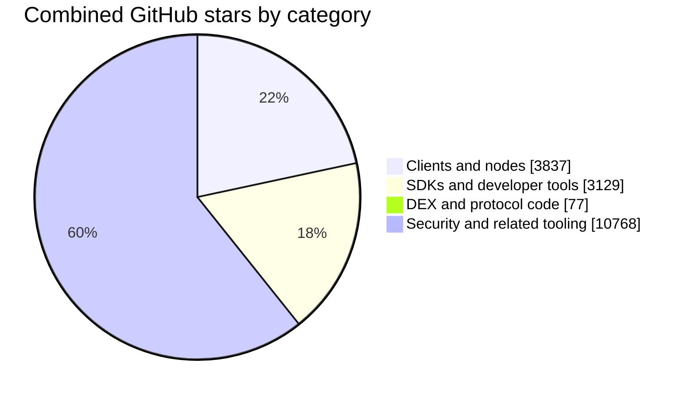

# Awesome Craft BSC 

> A curated list of verified open-source clients, SDKs, dev tools and protocol code for BNB Smart Chain and opBNB.

Deploying contracts, running validators or forking DEX code carries real financial and operational risk. This list is not investment or yield advice.

This list is specific to BNB Chain. General DEX protocol code and multi-chain infra also appear in Awesome Craft Web3; prefer that list for Uniswap-style protocol source, and this one for BNB Chain clients and official tooling. Deploying contracts or running validators carries operational and financial risk. This list is not investment or yield advice. Some BNB Chain repositories have historically targeted the retired Beacon Chain; those are labelled.

## Contents

- [Dashboard](#dashboard)
- [Clients and nodes](#clients-and-nodes)
- [SDKs and developer tools](#sdks-and-developer-tools)
- [DEX and protocol code](#dex-and-protocol-code)
- [Security and related tooling](#security-and-related-tooling)
- [Related lists](#related-lists)
- [Star history](#star-history)

## Dashboard

<table>
<tr>
<td align="center"><h2>11</h2>listed projects</td>
<td align="center"><h2>4</h2>categories</td>
<td align="center"><h2>17.8k</h2>combined GitHub stars</td>
<td align="center"><h2>8.0k</h2>combined forks</td>
<td align="center"><h2>6/10</h2>pushed in the last 30 days</td>
<td align="center"><h2>5</h2>languages</td>
</tr>
</table>

**FACT** (snapshot taken 2026-11-15, GitHub API): 11 listed projects, 10 of them on GitHub with public repository statistics. Official documentation and other non-GitHub entries are listed but have no stars, forks or push dates.

**ESTIMATE**: 17.8k combined GitHub stars and 8.0k combined forks, summed from those API counts on the snapshot date. Live star badges next to GitHub entries may differ.

### 🏆 Leaderboard

<table>
<tr><th>Rank</th><th>Project</th><th>Kind</th><th align="right">Stars</th><th></th></tr>
<tr><td align="center">🥇</td><td><b>Foundry</b></td><td>EVM toolchain</td><td align="right">10.8k</td><td><code>████████████████████</code></td></tr>
<tr><td align="center">🥈</td><td><b>BSC</b></td><td>Execution client</td><td align="right">3.3k</td><td><code>██████</code></td></tr>
<tr><td align="center">🥉</td><td><b>BNB Evolution Proposals</b></td><td>Specifications</td><td align="right">992</td><td><code>██</code></td></tr>
<tr><td align="center">4</td><td><b>bsc-genesis-contract</b></td><td>Genesis contracts</td><td align="right">781</td><td><code>█</code></td></tr>
<tr><td align="center">5</td><td><b>BNB Chain documentation</b></td><td>Official docs site</td><td align="right">549</td><td><code>█</code></td></tr>
<tr><td align="center">6</td><td><b>opBNB</b></td><td>L2 node</td><td align="right">432</td><td><code>█</code></td></tr>
<tr><td align="center">7</td><td><b>example-hub</b></td><td>Examples</td><td align="right">406</td><td><code>█</code></td></tr>
<tr><td align="center">8</td><td><b>javascript-sdk</b></td><td>JavaScript SDK</td><td align="right">401</td><td><code>█</code></td></tr>
<tr><td align="center">9</td><td><b>reth-bsc</b></td><td>Execution client</td><td align="right">90</td><td><code>█</code></td></tr>
<tr><td align="center">10</td><td><b>PancakeSwap v3 contracts</b></td><td>DEX contracts</td><td align="right">77</td><td><code>█</code></td></tr>
</table>

### Stars by category

### Licences

     

"Custom" or "None" means GitHub could not match a standard SPDX licence, often because of extra terms or an undeclared licence. Read the project licence before you use it commercially.

## Clients and nodes

- [BSC](https://github.com/bnb-chain/bsc) - The official BNB Smart Chain execution client, a go-ethereum fork, published by bnb-chain. 
- [opBNB](https://github.com/bnb-chain/opbnb) - The official opBNB node software, BNB Chain's OP-stack style Layer 2, published by bnb-chain. 
- [reth-bsc](https://github.com/bnb-chain/reth-bsc) - A Reth-based BNB Smart Chain client published by bnb-chain. 

## SDKs and developer tools

- [BNB Chain documentation](https://github.com/bnb-chain/bnb-chain.github.io) - The official BNB Chain documentation repository. 
- [BNB Evolution Proposals](https://github.com/bnb-chain/BEPs) - The official design and specification repository for BNB Chain. 
- [bsc-genesis-contract](https://github.com/bnb-chain/bsc-genesis-contract) - Official genesis contracts for BNB Smart Chain. Confirm the repository licence file; GitHub may report a non-standard or unmatched licence. 
- [example-hub](https://github.com/bnb-chain/example-hub) - Official frontend, agent-kit and smart-contract examples for BNB Chain developers. 
- [javascript-sdk](https://github.com/bnb-chain/javascript-sdk) - A JavaScript SDK originally aimed at BNB Beacon Chain. Confirm whether it matches the Smart Chain or Beacon Chain APIs you need before using it in a new project. 

## DEX and protocol code

- [PancakeSwap pancake-frontend](https://github.com/pancakeswap/pancake-frontend) - The PancakeSwap web frontend, a major BNB Chain DEX UI. Review the repository licence and notice that frontend code is not the same as audited on-chain contracts. 
- [PancakeSwap v3 contracts](https://github.com/pancakeswap/pancake-v3-contracts) - PancakeSwap v3 smart contracts. Deploying or forking DEX contracts carries financial risk and needs an independent audit. Confirm the current licence before a commercial fork. 

## Security and related tooling

- [Foundry](https://github.com/foundry-rs/foundry) - A general EVM development toolkit commonly used to test and deploy BNB Chain contracts. Also listed in the Web3 and Ethereum lists because it is not BSC-specific. 

## Related lists

Other lists in the Awesome Craft series:

- [Awesome Craft](https://github.com/EdisonTKPcom/Awesome-Craft) - A curated list of open-source, self-hostable alternatives to popular SaaS tools.
- [Awesome Craft Agents](https://github.com/EdisonTKPcom/Awesome-Craft-Agents) - A curated list of open-source chat apps, coding agents, self-hosted agent bots, workflow automation and image-generation UIs.
- [Awesome Craft AI](https://github.com/EdisonTKPcom/Awesome-Craft-AI) - A curated list of open-source, self-hostable AI runtimes, servers, Hugging Face libraries and related infrastructure.
- [Awesome Craft Creative](https://github.com/EdisonTKPcom/Awesome-Craft-Creative) - A curated list of open-source creative apps, including the storytold Craft App Suite and tools for photo, video, animation, 3D, audio and design.
- [Awesome Craft CUDA](https://github.com/EdisonTKPcom/Awesome-Craft-CUDA) - A curated list of open-source CUDA learning material, kernel libraries, tooling and portability projects.
- [Awesome Craft DeepSeek](https://github.com/EdisonTKPcom/Awesome-Craft-DeepSeek) - A curated list of official DeepSeek repositories and open-source harnesses, serving engines, eval tools and fine-tuning stacks that work with DeepSeek models.
- [Awesome Craft DevOps](https://github.com/EdisonTKPcom/Awesome-Craft-DevOps) - A curated list of open-source, self-hostable alternatives to popular DevOps and hosting SaaS tools.
- [Awesome Craft DNA](https://github.com/EdisonTKPcom/Awesome-Craft-DNA) - A curated list of open-source tools for DNA, genomics and synthetic biology.
- [Awesome Craft Ethereum](https://github.com/EdisonTKPcom/Awesome-Craft-Ethereum) - A curated list of verified open-source Ethereum clients, SDKs, dev frameworks, wallets and security tools.
- [Awesome Craft EV](https://github.com/EdisonTKPcom/Awesome-Craft-EV) - A curated list of open-source software and hardware for electric vehicles and charging.
- [Awesome Craft Hardware](https://github.com/EdisonTKPcom/Awesome-Craft-Hardware) - A curated list of open-source tools for PCB, FPGA, ASIC and chip design.
- [Awesome Craft Hyperliquid](https://github.com/EdisonTKPcom/Awesome-Craft-Hyperliquid) - A curated list of verified open-source SDKs, node tools, analytics and community libraries for the Hyperliquid ecosystem.
- [Awesome Craft Jarvis](https://github.com/EdisonTKPcom/Awesome-Craft-Jarvis) - A curated list of open-source tools to run a personal JARVIS-style AI assistant locally, including dashboards, agent runtimes, voice, MCP connections and memory.
- [Awesome Craft Malaysia](https://github.com/EdisonTKPcom/Awesome-Craft-Malaysia) - A curated list of open-source tools useful to Malaysian SMEs, with verified MyInvois support called out separately.
- [Awesome Craft Mars](https://github.com/EdisonTKPcom/Awesome-Craft-Mars) - A curated list of open-source tools and open data for Mars missions and settlement planning.
- [Awesome Craft Neuro](https://github.com/EdisonTKPcom/Awesome-Craft-Neuro) - A curated list of open-source tools for brain-computer interfaces, electrophysiology and neurotechnology.
- [Awesome Craft Robotics](https://github.com/EdisonTKPcom/Awesome-Craft-Robotics) - A curated list of open-source robotics software and hardware, including Microduck, Unitree SDKs, open humanoids, arms, simulation and middleware.
- [Awesome Craft SecondBrain](https://github.com/EdisonTKPcom/Awesome-Craft-SecondBrain) - A curated list of open-source tools for a personal second brain, including knowledge apps, LLM memory layers, RAG over notes, capture tools, MCP servers and knowledge graphs.
- [Awesome Craft Solana](https://github.com/EdisonTKPcom/Awesome-Craft-Solana) - A curated list of verified open-source Solana clients, SDKs, frameworks, explorers and program libraries.
- [Awesome Craft Space](https://github.com/EdisonTKPcom/Awesome-Craft-Space) - A curated list of open-source tools for spaceflight and rockets, covering orbit simulation, telemetry, launch data and more.
- [Awesome Craft Starlink](https://github.com/EdisonTKPcom/Awesome-Craft-Starlink) - A curated list of open-source tools for Starlink and other LEO satellite internet systems.
- [Awesome Craft Web3](https://github.com/EdisonTKPcom/Awesome-Craft-Web3) - A curated list of open-source DEX protocol code, self-custody software, indexers, frameworks and Blockchain infrastructure.

## Star history

## Contributing

Contributions welcome! Read the [contribution guidelines](contributing.md) first.

If this list is useful, give it a ⭐ so others can find it.

